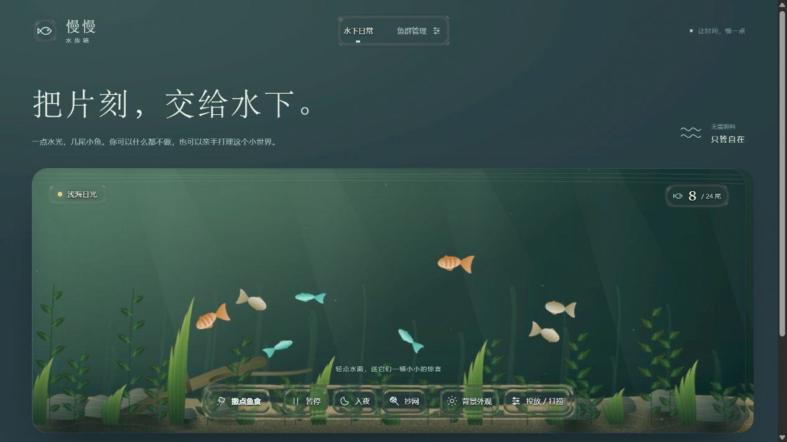

# 慢慢水族箱

**在线体验：[打开慢慢水族箱](https://lcoer.github.io/idle-aquarium/)**

一个可以投喂、养鱼和打理的浏览器水族箱。鱼与水草采用自然彩色外观，搭配砂石、沉木、水流摆动和水下光影；工具栏与外观面板保留液态玻璃效果。



当前为轻量的 **2.5D 自然风格**，并非照片级 3D。无后端，资源本地打包，运行时不需要外网。

## 快速运行

下载或克隆仓库后，在项目目录启动任意静态服务器，例如：

```powershell
python -m http.server 8765 --bind 127.0.0.1
```

在浏览器打开 <http://127.0.0.1:8765/>。仓库包含构建产物，只预览页面无需安装 npm 依赖。请保留整个项目的目录结构。

## 功能

- 点击水面、按住拖动或按 `F` 投喂；空格暂停，切换昼夜。
- 三种鱼种：琥珀锦鱼、碧玉灯鱼、月白银鱼。默认 10 尾，上限 24 尾。
- 「投放 / 打捞」配置鱼种、数量、体型、游速和成长阶段；支持按规则打捞和手动抄网，最近一次打捞可在 15 秒内撤销。
- 「背景外观 → 氛围配色 → 自然草缸」切换自然配色，也可以独立调整环境底色、浅水色、深水色和明度。
- 自定义本地背景图片，支持位置、暗色遮罩及应用到水下。最大 20 MB，导入后缩小并转为 JPEG 保存在浏览器中。
- 玻璃控件提供自动、Plus、轻量模式。参考条纹默认关闭，按需开启可查看折射效果。
- 鱼群成长、主题、外观与背景自动保存到浏览器。鱼和图片不会上传到服务器。

小鱼约 20 分钟长大，成年鱼吃饱后可缓慢繁殖。不喂不会饿死，没有捕食、自然死亡或离线生态。系统开启减少动态效果时，首次打开默认暂停。

存档与浏览器和站点地址绑定。换端口、域名或浏览器通常会使用不同存档；清除站点数据会删除本地存档。允许空缸，刷新不会自动补鱼。

## 开发与验证

需要 Node.js 和 npm：

```powershell
npm ci --ignore-scripts --registry=https://registry.npmjs.org
npm run build
npm test
```

- 原生 HTML/CSS/Canvas 负责页面、自然场景和鱼群行为。
- React 19 与 Three.js 0.186.1 负责局部玻璃光学层。
- esbuild 将 `glass-react.jsx` 打包到 `vendor/glass-react.bundle.js`，修改相关源码后需重新构建。
- 测试覆盖存档、投喂、成长、投放打捞、外观、背景与兼容模式；当前 40 项通过。
- 上传到任意静态托管平台即可运行；本仓库通过 GitHub Pages 发布 `main` 分支根目录，后续推送后会自动更新网站。

开发技能属于本地工具，未随运行项目上传。自然材质与动画改造说明见 [NATURALISM.md](NATURALISM.md)，玻璃层说明见 [OPTICS.md](OPTICS.md)。

## 来源与许可

基于 [wenonly/desktop-aquarium](https://github.com/wenonly/desktop-aquarium) 的 MIT 版本改造，上游提交 `805450e148fbd8ff569e57fc5992afaa451872e4`。保留原许可，详见 [LICENSE](LICENSE) 和 [THIRD_PARTY_NOTICES.md](THIRD_PARTY_NOTICES.md)。

自然场景参考了 [jamisonhill/aquarium](https://github.com/jamisonhill/aquarium) 的共享水流与程序化造景思路，以及 [reki2000/aquarium](https://github.com/reki2000/aquarium) 的自然材质与水下明暗层次；未复制其模型或渲染实现。图像、鱼、水草与砂石均由代码绘制。
